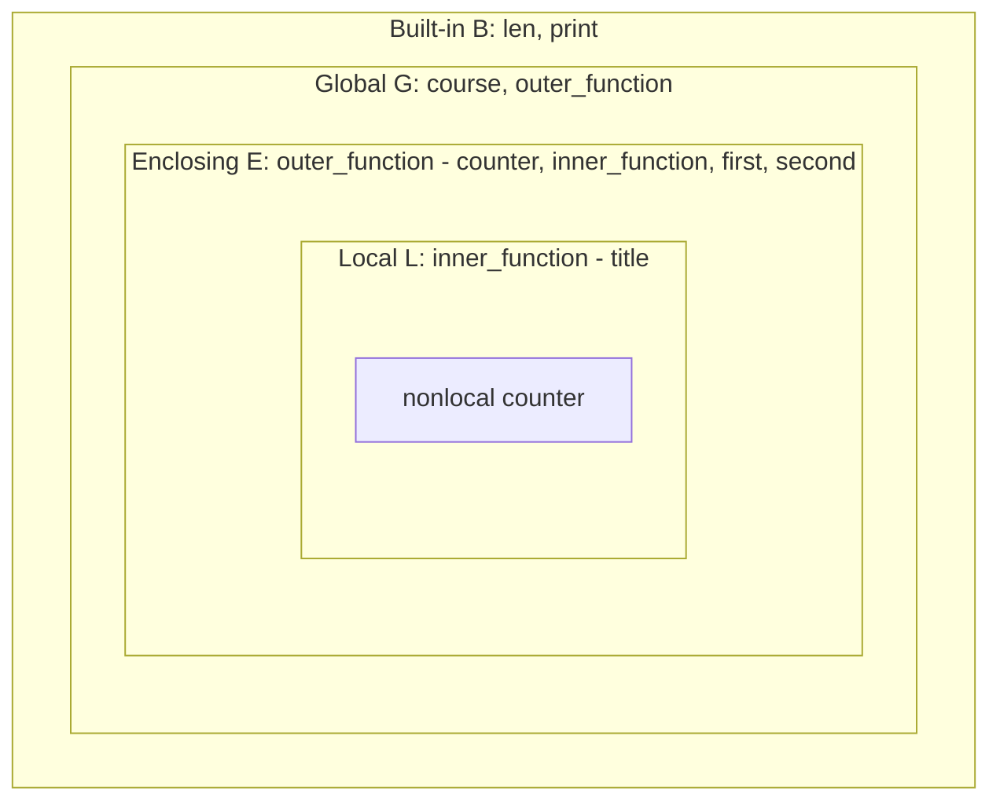

# Лабораторная работа № 3. Алгоритмы, коллекции и функции

## Цель работы

Научиться переводить условие задачи в алгоритм, выбирать подходящую структуру данных и разделять программу на небольшие функции с понятными контрактами.

## Задание 1. Условия и классификация данных

Создайте `task_1.py`. Программа получает:

- целое число от 0 до 100 — результат студента;
- строку `exam`, `project` или `practice` — тип работы;
- целое число от 0 до 5 — количество пропущенных занятий.

Можно считать, что данные введены в корректном формате.

### Часть 1. Проверка диапазонов

С помощью `if / elif / else` проверьте, что результат и количество пропусков входят в допустимые диапазоны. Если хотя бы одно значение некорректно, выведите сообщение и не выполняйте дальнейшую классификацию.
```python
res=int(input())
type=str(input())
skip=int(input())

if res<0 or res>100:
    print("Значение res некорректно")
elif skip<0 or skip>5:
    print("Значение skip некорректно")
else:
    print('Данные skip и res введены корректно')
```

### Часть 2. Определение уровня результата

Назначим уровень:

| Результат | Уровень |
|---:|---|
| 90–100 | отличный |
| 75–89 | хороший |
| 60–74 | удовлетворительный |
| 0–59 | недостаточный |

Если пропущено более трех занятий, уровень снижается на одну ступень, но не может стать ниже уровня «недостаточный».
```python
res=int(input())
work=str(input())
skip=int(input())

if res<0 or res>100:
    print("Значение res некорректно")
elif skip<0 or skip>5:
    print("Значение skip некорректно")
else:
    skip_flag=0
    if skip>3:
        skip_flag=1
    if res<60:
        level='недостаточный'
    elif res<75:
        if not skip_flag:
            level='удовлетворительный'
        else:
            level = 'недостаточный'
    elif res<90:
        if not skip_flag:
            level='хороший'
        else:
            level = 'удовлетворительный'
    else:
        if not skip_flag:
            level='отличный'
        else:
            level = 'хороший'
    print('уровень:', level)
```

### Часть 3. Сопоставление с образцом

С помощью `match / case` сформируйте пояснение для типа работы:

- `exam` — экзаменационная работа;
- `project` — проектная работа;
- `practice` — практическая работа.

Для неизвестного значения предусмотрите отдельную ветвь.
```python
match work:
    case 'exam':
        print(work, '— экзаменационная работа')
    case 'project':
        print(work, '—  проектная работа')
    case 'practice':
        print(work, '—  практическая работа')
    case _:
        print("Значение work некорректно")
```

### Часть 4. Тестовые сценарии

Проверьте программу не менее чем на восьми наборах данных, включая границы диапазонов: `0`, `59`, `60`, `74`, `75`, `89`, `90`, `100`.

В `REPORT.md` приведите таблицу сценариев с ожидаемыми и фактическими результатами. Объясните порядок проверки условий и укажите, какие ветви недостижимы при выбранном порядке.

#### Таблица сценариев тестирования

| № | res | work | skip | Ожидаемый результат | Фактический результат | Пояснение                                                                   |
|---|---|---|---|---|---|-----------------------------------------------------------------------------|
| 1 | 0 | exam | 0 | уровень: недостаточный<br>exam — экзаменационная работа | уровень: недостаточный<br>exam — экзаменационная работа | Граница: минимальный результат, без пропусков                               |
| 2 | 59 | project | 3 | уровень: недостаточный<br>project — проектная работа | уровень: недостаточный<br>project — проектная работа | Граница: 59 (недостаточный), пропусков ровно 3 (не влияет)                  |
| 3 | 60 | practice | 4 | уровень: недостаточный<br>practice — практическая работа | уровень: недостаточный<br>practice — практическая работа | Граница: 60 (удовлетворительный), но skip > 3 - понижение до недостаточного |
| 4 | 74 | exam | 5 | уровень: недостаточный<br>exam — экзаменационная работа | уровень: недостаточный<br>exam — экзаменационная работа | Граница: 74 (удовлетворительный), максимальные пропуски (5)                 |
| 5 | 75 | project | 0 | уровень: хороший<br>project — проектная работа | уровень: хороший<br>project — проектная работа | Граница: 75 (хороший), без пропусков                                        |
| 6 | 89 | practice | 3 | уровень: хороший<br>practice — практическая работа | уровень: хороший<br>practice — практическая работа | Граница: 89 (хороший), пропусков ровно 3 (не влияет)                        |
| 7 | 90 | exam | 4 | уровень: хороший<br>exam — экзаменационная работа | уровень: хороший<br>exam — экзаменационная работа | Граница: 90 (отличный), skip > 3 → понижение до хорошего                    |
| 8 | 100 | project | 5 | уровень: хороший<br>project — проектная работа | уровень: хороший<br>project — проектная работа | Граница: максимальный результат, максимальные пропуски                      |
| 9 | 101 | exam | 0 | Значение res некорректно | Значение res некорректно | Некорректное значение res                                                   |
| 10 | 50 | practice | 6 | Значение skip некорректно | Значение skip некорректно | Некорректное значение skip                                                  |

### Практическое расширение

После проверки одной записи обработайте список минимум из десяти записей вида `(score, work_type, absences)`. Для каждой записи сформируйте готовую строку результата, а затем подсчитайте число студентов каждого уровня. Исходные данные не изменяйте. Программа должна вывести индивидуальные результаты и итоговую сводку.

```python
students = [
(95, "exam", 1),
(85, "project", 4),
(72, "practice", 2),
(58, "exam", 0),
(60, "project", 5),
(100, "practice", 3),
(75, "exam", 4),
(45, "project", 1),
(90, "practice", 0),
(74, "exam", 3)]

results=[]
level_counter=[0]*4

def stats(score, work_type, absences):
    if score < 0 or score > 100:
        level = None
        type=None
    elif absences < 0 or absences > 5:
        level = None
        type = None
    else:
        absences_flag = 0
        if absences > 3:
            absences_flag = 1
        if score < 60:
            level_counter[0] += 1
            level = 'недостаточный'
        elif score < 75:
            if not absences_flag:
                level_counter[1] += 1
                level = 'удовлетворительный'
            else:
                level_counter[0] += 1
                level = 'недостаточный'
        elif score < 90:
            if not absences_flag:
                level_counter[2] += 1
                level = 'хороший'
            else:
                level_counter[1] += 1
                level = 'удовлетворительный'
        else:
            if not absences_flag:
                level_counter[3] += 1
                level = 'отличный'
            else:
                level_counter[2] += 1
                level = 'хороший'


        match work_type:
            case 'exam':
                type = 'экзаменационная работа'
            case 'project':
                type = 'проектная работа'
            case 'practice':
                type = 'практическая работа'
            case _:
                type = None
    return level, type

for score, work_type, absences in students:
    level, type = stats(score, work_type, absences)
    if level is None or type is None:
        results.append(f"[{score}, {work_type}, {absences}] - {type}")
    else:
        line = f"[{score}, {work_type}, {absences}] - уровень: {level} ({type})"
        results.append(line)

print("Индивидуальные результаты:")
for line in results:
    print(line)

print("\nИтоговая сводка:")
order = ['недостаточный','удовлетворительный','хороший','отличный']
for x in range(len(level_counter)):
    print(f"  {order[x]}: {level_counter[x]}")
print(f"Всего обработано: {len(students)}")
```
```
Индивидуальные результаты:
[95, exam, 1] - уровень: отличный (экзаменационная работа)
[85, project, 4] - уровень: удовлетворительный (проектная работа)
[72, practice, 2] - уровень: удовлетворительный (практическая работа)
[58, exam, 0] - уровень: недостаточный (экзаменационная работа)
[60, project, 5] - уровень: недостаточный (проектная работа)
[100, practice, 3] - уровень: отличный (практическая работа)
[75, exam, 4] - уровень: удовлетворительный (экзаменационная работа)
[45, project, 1] - уровень: недостаточный (проектная работа)
[90, practice, 0] - уровень: отличный (практическая работа)
[74, exam, 3] - уровень: удовлетворительный (экзаменационная работа)

Итоговая сводка:
  недостаточный: 3
  удовлетворительный: 4
  хороший: 0
  отличный: 3
Всего обработано: 10

```
---

## Задание 2. Циклы и базовые алгоритмические схемы

Создайте `task_2.py`. Исходные данные:

```python
measurements = [12, 15, 11, 18, 18, 9, 21, 15, 7, 18]
```

Не используя `min()`, `max()`, `sum()` и `list.count()`, реализуйте за один проход:

- вычисление суммы;
- поиск минимального значения;
- поиск максимального значения;
- подсчет четных значений;
- подсчет значений, превосходящих среднее арифметическое.

```python
measurements = [12, 15, 11, 18, 18, 9, 21, 15, 7, 18]

total = 0
min_val = float('inf')
max_val = float('-inf')
even = 0
n = 0

for x in measurements:
    # сумма
    total += x
    
    # максимум
    if x < min_val:
        min_val = x
        
    # минимум
    if x > max_val:
        max_val = x
    
    # количество четных
    if x % 2 == 0:
        even += 1
    
    # количество элементов
    n += 1

mid = total / n
gt = 0
for x in measurements:
    if x > mid:
        gt += 1

print('сумма:', total)
print('минимум:', min_val)
print('максимум:', max_val)
print('четных чисел:', even)
print('больше среднего арифметического:', gt)
```
```
сумма: 144
минимум: 7
максимум: 21
четных чисел: 4
больше среднего арифметического: 6
```

Последний пункт требует второго прохода, поскольку среднее становится известно после вычисления суммы. Разделите решение на понятные этапы.

Затем реализуйте линейный поиск первого вхождения числа, введенного пользователем. Если число отсутствует, программа должна вывести `-1`.

```python
measurements = [12, 15, 11, 18, 18, 9, 21, 15, 7, 18]

k=int(input())
flag=False
for x in range(len(measurements)):
    if measurements[x]==k:
        print(x)
        flag=True
        break
if not flag:
    print(-1)
```

### Дополнительный алгоритмический эксперимент

Реализуйте проверку простоты положительного целого числа. Перебирайте возможные делители только до квадратного корня из числа включительно. Не используйте готовые функции проверки простоты.

```python
import math
def is_prime(n):
    if n < 2:
        return False
    for i in range(2, int(math.sqrt(n)) + 1):
        if n % i == 0:
            return False
    return True

p=int(input())
print(is_prime(p))
```
Для каждого реализованного алгоритма укажите временную сложность через `O(...)` и объясните:

- от какого параметра зависит число операций;

От значения самого числа n(O(sqrt(n)) для определения простоты числа)

- сколько дополнительной памяти требуется;

O(1) - только несколько целочисленных переменных.

- почему ограничение делителей квадратным корнем корректно.

Если число `n` составное, то `n = a · b`, где `a, b > 1`. Если бы оба множителя были строго больше корня из `n`, то их произведение было бы `a · b > sqrt(n) · sqrt(n) = n`

### Практическое расширение

Самостоятельно реализуйте сортировку выбором и бинарный поиск в отсортированном списке. Для линейного и бинарного поиска считайте количество выполненных сравнений. Запустите оба алгоритма на одинаковых наборах из 10, 100 и 1000 элементов и выведите сравнительную таблицу. Не измеряйте только время: основным результатом должно быть число сравнений.

```
Псевдокод сортировки выбором:
SelectionSort(A[0..n-1]) # A — массив из n элементов
    for i = 0 to n - 2 do
        minIdx = i
        for j = i + 1 to n - 1 do
            if A[j] < A[minIdx] then
                minIdx = j
        if minIdx != i then
            swap(A[i], A[minIdx])
```
```
Псевдокод бинарного поиска:
BinarySearch(A[0..n-1], target)   # A — отсортированный массив из n элементов
    left = 0
    right = n - 1

    while left <= right do
        mid = (left + right) div 2

        if A[mid] == target then
            return mid
        else if A[mid] < target then
            left = mid + 1
        else
            right = mid - 1

    return -1
```
```python
import random
def selection_sort(arr):
    n = len(arr)
    for i in range(n):
        min_idx = i
        for j in range(i + 1, n):
            if arr[j] < arr[min_idx]:
                min_idx = j
        arr[i], arr[min_idx] = arr[min_idx], arr[i]


def linear_search(arr, target):
    comparisons = 0
    for i in range(len(arr)):
        comparisons += 1
        if arr[i] == target:
            return i, comparisons
    return -1, comparisons


def binary_search(arr, target):
    comparisons = 0
    left, right = 0, len(arr) - 1

    while left <= right:
        comparisons += 1
        mid = (left + right) // 2

        if arr[mid] == target:
            return mid, comparisons
        elif arr[mid] < target:
            left = mid + 1
        else:
            right = mid - 1

    return -1, comparisons

sizes = [10, 100, 1000]
results = []
for size in sizes:
    arr = [random.randint(1, size * 10) for _ in range(size)]

    selection_sort(arr)

    # Выбираем элемент для поиска
    target = arr[random.randint(0, len(arr) - 1)]

    ind_lin, linear_comparisons = linear_search(arr, target)
    ind_bin, binary_comparisons = binary_search(arr, target)

    results.append({'size': size, 'linear_comparisons': linear_comparisons, 'binary_comparisons': binary_comparisons})
print(f"{'Размер'} {'Количество сравнений в линейном поиске'} {'Количество сравнений в бинарном поиске'}")
for r in results:
    print(f"{r['size']} {r['linear_comparisons']} {r['binary_comparisons']}")
```
| Размер списка | Количество сравнений в линейном поиске | Количество сравнений в бинарном поиске |
|---------------|----------------------------------------|----------------------------------------|
| 10            | 8                                      | 2                                      |
| 100           | 49                                     | 7                                      |
| 1000          | 494                                    | 9                                      |

Временная сложность:

Сортировка выбором: O(n<sup>2</sup>) - всегда выполняет n(n-1)/2 сравнений

Линейный поиск: O(n) - в худшем случае n сравнений

Бинарный поиск: O(log n) - в худшем случае log n + 1 сравнений

---

## Задание 3. Коллекции и выбор структуры данных

Создайте `task_3.py`. Используйте данные о сдаче лабораторных работ:

```python
submissions = [
    ("anna", "lab_01", 5),
    ("boris", "lab_01", 4),
    ("anna", "lab_02", 5),
    ("daria", "lab_01", 3),
    ("boris", "lab_02", 5),
    ("anna", "lab_01", 4),
]
```

Каждый кортеж содержит имя студента, идентификатор работы и результат попытки.

Постройте:

1. Множество всех студентов.
2. Множество всех сданных лабораторных работ.
3. Словарь, в котором каждому студенту соответствует список его попыток.
4. Словарь лучших результатов по ключу `(student, laboratory)`.
5. Словарь количества попыток для каждой пары `(student, laboratory)`.

Выведите студентов, которые сдавали обе работы, используя операции над множествами.
```python
# 1) Множество всех студентов (уникальные имена)
students = {s[0] for s in submissions}

# 2) Множество всех сданных лабораторных работ (уникальные идентификаторы)
labs = {s[1] for s in submissions}

# 3) Словарь: студент -> список его попыток
attempts_by_student = {}
for s in submissions:
    if s[0] not in attempts_by_student:
        attempts_by_student[s[0]] = []
    attempts_by_student[s[0]].append(s)

# 4) Словарь: (студент, лабораторная) -> лучший балл
best_scores = {}
for s in submissions:
    key = (s[0], s[1])
    best_scores[key] = max(best_scores.get(key, -1), s[2])

# 5) Словарь: (студент, лабораторная) -> количество попыток
attempt_counts = {}
for s in submissions:
    key = (s[0], s[1])
    attempt_counts[key] = attempt_counts.get(key, 0) + 1

# Словарь "лабораторная -> множество студентов, её сдававших"
# нужен для поиска студентов, сдавших обе работы.
students_per_lab = {}
for s in submissions:
    students_per_lab.setdefault(s[1], set()).add(s[0])

# Сдали обе работы:
common_students = set.intersection(*students_per_lab.values())
print(common_students)
```
```
{'anna', 'boris'}
```
Добавьте новую запись и обновите структуры без полного повторного построения. 
```python
new_record = ("daria", "lab_02", 4)

students.add(new_record[0])                       # set: O(1)
labs.add(new_record[1])                           # set: O(1)
attempts_by_student.setdefault(new_record[0], []).append(new_record)  # dict+list: O(1)

key = (new_record[0], new_record[1])
best_scores[key] = max(best_scores.get(key, -1), new_record[2])       # dict: O(1)
attempt_counts[key] = attempt_counts.get(key, 0) + 1                  # dict: O(1)
students_per_lab.setdefault(new_record[1], set()).add(new_record[0])  # dict+set: O(1)
```

Объясните, почему:

- множество подходит для хранения уникальных значений;

Множество в Python реализовано на базе хеш-таблицы: при добавлении элемента вычисляется его хеш, и элемент помещается в «корзину». Если элемент с таким хешом и значением уже существует - он игнорируется. Поэтому дубликаты физически не могут появиться, а проверка принадлежности и вставка выполняются за O(1) в среднем.

- кортеж можно использовать как ключ словаря;

Ключом словаря может быть любой хешируемый объект. Хешируемыми в Python являются неизменяемые типы int, str, float, bool, tuple.

- список нельзя использовать как ключ словаря;

Потому что список - изменяемый объект, а значит, нехешируемый (если бы он был хешируемым, его хеш бы изменялся при каждом изменении списка).
При попытке сделать список ключом получим `TypeError: unhashable type: 'list'`.

- словарь предпочтительнее списка для частого поиска результата по составному ключу.
Словарь предпочтительнее, потому что проверка вхождения в него занимает O(1), а в списке - O(n).

В `REPORT.md` приведите оценку средней сложности добавления и поиска для использованных коллекций.
```
set - добавление (add)  - O(1) 
set - проверка (in)   - O(1)
dict - поиск по ключу  - O(1)
dict  - вставка  - O(1)  
list - добавление в конец(append)  - O(1) 
list - поиск элемента (in) - O(n)   
```

### Практическое расширение

Реализуйте текстовые запросы к построенным данным:

```text
student anna
best anna lab_01
attempts boris lab_02
completed lab_01
```

Команда разбирается на части, после чего программа выбирает подходящую операцию и выводит результат. Поддержите неизвестную команду и отсутствие требуемого ключа без аварийного завершения программы.

```python
inf=list(input().split())

match inf[0]:
    case 'student':
        if len(inf)==2 and inf[1] in attempts_by_student:
            print(f'Все попытки студента {inf[1]}')
            for _,x,y in attempts_by_student[inf[1]]:
                print(x,y)
        else:
            print("Некорректный ввод аргументов")
    case 'best':
        if len(inf)==3 and (inf[1], inf[2]) in best_scores:
            print(f'Лучшая попытка студента {inf[1]} по лабораторной {inf[2]}')
            print(best_scores[(inf[1], inf[2])])
        else:
            print("Некорректный ввод аргументов")
    case 'attempts':
        if len(inf)==3 and (inf[1], inf[2]) in attempt_counts:
            print(f'Все попытки студента {inf[1]} по лабораторной {inf[2]}')
            print(attempt_counts[(inf[1], inf[2])])
        else:
            print("Некорректный ввод аргументов")
    case 'completed':
        if len(inf)==2 and inf[1] in students_per_lab:
            print(f'Все студенты, кто сдал лабораторную {inf[1]}')
            print(students_per_lab[inf[1]])
        else:
            print("Некорректный ввод аргументов")
    case _:
        print("Некорректная команда")
```
student anna
```
Все попытки студента anna
lab_01 5
lab_02 5
lab_01 4
```
best anna lab_01
```
Лучшая попытка студента anna по лабораторной lab_01
5
```
attempts boris lab_02
```
Все попытки студента boris по лабораторной lab_02
1
```
completed lab_01
```
Все студенты, кто сдал лабораторную lab_01
{'boris', 'anna', 'daria'}
```

---

## Задание 4. Функции, параметры и области видимости

Создайте `task_4.py` и реализуйте функции:

```python
def arithmetic_mean(values: list[float]) -> float:
    """Возвращает среднее арифметическое непустого списка."""


def normalize_name(name: str) -> str:
    """Удаляет лишние пробелы и приводит каждую часть имени к нужному регистру."""


def build_report(
    student: str,
    results: list[int],
    *,
    precision: int = 2,
    prefix: str = "Результат",
) -> str:
    """Формирует строковый отчет о результатах студента."""


def collect_tags(*tags: str, lowercase: bool = True) -> tuple[str, ...]:
    """Возвращает очищенные теги без пустых значений и повторов."""
```

Требования:

1. Не изменяйте полученные коллекции внутри функций.
2. Используйте ранний `return`, если функция не может выполнить контракт.
3. Для `build_report()` оставьте `precision` и `prefix` только именованными параметрами.
4. Добавьте не менее трех проверок через `assert` для каждой функции.
5. Покажите корректные вызовы функций с позиционными и именованными аргументами.
6. Добавьте демонстрацию распаковки списка через `*` и словаря через `**` при вызове функции.

```python
import math

def arithmetic_mean(values: list[float]) -> float:
    """Возвращает среднее арифметическое непустого списка"""
    if not values:
        # Пустой список
        return float("nan")
    return sum(values) / len(values)


def normalize_name(name: str) -> str:
    """Удаляет лишние пробелы и приводит каждую часть имени к нужному регистру"""
    parts = name.split()  # Убираем лишние пробелы
    if not parts:
        return ""
    # В каждой части первая буква заглавная, остальные строчные.
    # Дефисные имена обрабатываются по частям
    normalized = ["-".join(piece.capitalize() for piece in part.split("-")) for part in parts]
    return " ".join(normalized)


def build_report(
    student: str,
    results: list[int],
    *,
    precision: int = 2,
    prefix: str = "Результат",
) -> str:
    """Формирует строковый отчет о результатах студента"""
    name = normalize_name(student)
    if not results:
        return f"{prefix}: {name} - нет результатов"
    mean = arithmetic_mean(results)
    return (
        f"{prefix}: {name} - среднее {mean:.{precision}f}, "
        f"результатов: {len(results)}, "
        f"мин {min(results)}, макс {max(results)}"
    )


def collect_tags(*tags: str, lowercase: bool = True) -> tuple[str, ...]:
    """Возвращает очищенные теги без пустых значений и повторов"""
    seen: set[str] = set()
    cleaned: list[str] = []
    for tag in tags:
        value = tag.strip()
        if not value:
            continue
        if lowercase:
            value = value.lower()
        if value in seen:
            continue
        seen.add(value)
        cleaned.append(value)
    return tuple(cleaned)


def run_asserts() -> None:
    # arithmetic_mean
    nums = [4, 5, 3]
    snapshot = nums.copy()
    assert arithmetic_mean(nums) == 4.0
    assert arithmetic_mean([2.5]) == 2.5
    assert math.isnan(arithmetic_mean([]))
    assert nums == snapshot  # входной список не изменён

    # normalize_name
    assert normalize_name("  иВАНов   иван  ") == "Иванов Иван"
    assert normalize_name("анна-мария   петрова") == "Анна-Мария Петрова"
    assert normalize_name("   ") == ""
    assert normalize_name("") == ""

    # build_report
    res = [5, 4, 4]
    res_snapshot = res.copy()
    assert build_report("иванов иван", res) == ("Результат: Иванов Иван - среднее 4.33, результатов: 3, мин 4, макс 5")
    assert build_report("иванов иван", res, precision=0) == ("Результат: Иванов Иван - среднее 4, результатов: 3, мин 4, макс 5")
    assert build_report("иванов иван", res, prefix="Итог", precision=1) == ("Итог: Иванов Иван - среднее 4.3, результатов: 3, мин 4, макс 5")
    assert build_report("иванов иван", []) == "Результат: Иванов Иван - нет результатов"
    assert res == res_snapshot
    # precision и prefix — только именованные:
    try:
        build_report("иванов", res, 3)
    except TypeError:
        pass
    else:
        raise AssertionError("precision не должен приниматься позиционно")

    # collect_tags
    assert collect_tags(" Python ", "python", "", "  ", "OOP") == ("python", "oop")
    assert collect_tags("A", "a", "B", lowercase=False) == ("A", "a", "B")
    assert collect_tags() == ()
    assert collect_tags("x", "y", "x") == ("x", "y")
    assert isinstance(collect_tags("x"), tuple)


def demo() -> None:
    print("=== Позиционные и именованные аргументы ===")
    print('arithmetic_mean от [4, 5, 3] =',arithmetic_mean([4, 5, 3]))
    print(normalize_name("  пЕТРОВ   пётр "))
    print(build_report("сидорова анна", [5, 4, 5]))                                  # только позиционные
    print(build_report("сидорова анна", [5, 4, 5], precision=1, prefix="Итог"))     # позиционные + именованные
    print(build_report(student="сидорова анна", results=[5, 4, 5]))                 # обязательные по имени
    print(collect_tags("Python", " python ", "ООП", lowercase=False))

    print("=== Распаковка * (список) ===")
    tag_list = ["Python", " python", "", "Memory", "gc"]
    print(collect_tags(*tag_list))          # каждый элемент списка -> отдельный аргумент
    values = [3, 4, 5]
    print(build_report("иванов иван", values))
    print(arithmetic_mean([*values, 6]))    # распаковка при построении нового списка

    print("=== Распаковка ** (словарь) ===")
    options = {"precision": 3, "prefix": "Оценка"}
    print(build_report("иванов иван", values, **options))
    full = {"student": "петров пётр", "results": [2, 3], "precision": 0}
    print(build_report(**full))
    print(collect_tags(*tag_list, **{"lowercase": False}))


run_asserts()
print("Все assert-проверки пройдены")
demo()
```
```
Все assert-проверки пройдены
=== Позиционные и именованные аргументы ===
arithmetic_mean от [4, 5, 3] = 4.0
Петров Пётр
Результат: Сидорова Анна - среднее 4.67, результатов: 3, мин 4, макс 5
Итог: Сидорова Анна - среднее 4.7, результатов: 3, мин 4, макс 5
Результат: Сидорова Анна - среднее 4.67, результатов: 3, мин 4, макс 5
('Python', 'python', 'ООП')
=== Распаковка * (список) ===
('python', 'memory', 'gc')
Результат: Иванов Иван - среднее 4.00, результатов: 3, мин 3, макс 5
4.5
=== Распаковка ** (словарь) ===
Оценка: Иванов Иван - среднее 4.000, результатов: 3, мин 3, макс 5
Результат: Петров Пётр - среднее 2, результатов: 2, мин 2, макс 3
('Python', 'python', 'Memory', 'gc')
```

### Исследование LEGB

Добавьте фрагмент с глобальным именем `course`, внешней функцией и вложенной функцией. Во вложенной функции используйте `nonlocal` для изменения имени из объемлющей области. Не изменяйте глобальное имя.

```python
course = "Основы программирования"  # глобальное имя (область Global)


def outer_function() -> int:
    """Внешняя функция: владеет именем counter, вложенная функция его изменяет."""
    counter = 0  # локальное имя outer_function; для inner_function оно объемлющее (Enclosing)

    def inner_function() -> str:
        nonlocal counter  # counter ищется во вложенной области, локальное не создаётся
        counter += 1  # меняется связывание имени counter в outer_function
        title = f"{course}: вызов {counter}"  # course только читается, найдено в G
        return title

    first = inner_function()
    second = inner_function()
    print(first)
    print(second)
    print("длина заголовка:", len(second))  # len - встроенное имя (Built-in)
    return counter


def run_scope_asserts():
    original_course = course
    assert outer_function() == 2  # nonlocal изменил counter внутри outer_function
    assert outer_function() == 2  # новый вызов создаёт новое окружение, счёт заново
    assert course == original_course  # глобальное имя не изменено
    assert "counter" not in globals()  # nonlocal не создал глобальное имя
    assert "inner_function" not in globals()  # вложенная функция видна только внутри

print("=== Области видимости (LEGB, nonlocal) ===")
final_counter = outer_function()
print("counter после двух вызовов inner_function:", final_counter)
print("глобальный course без изменений:", course)

run_scope_asserts()
```
```
=== Области видимости (LEGB, nonlocal) ===
Основы программирования: вызов 1
Основы программирования: вызов 2
длина заголовка: 32
counter после двух вызовов inner_function: 2
глобальный course без изменений: Основы программирования
```

В `REPORT.md` нарисуйте схему областей видимости и объясните порядок поиска каждого использованного имени.



Правило LEGB: при чтении имени Python ищет его последовательно в областях Local, Enclosing, Global, Built-in и берёт первое найденное. Какая область считается локальной для имени, определяется при компиляции функции: если имя где-то в теле функции присваивается, оно локальное, если нет global или nonlocal.

### Ошибка изменяемого значения по умолчанию

Исследуйте и исправьте функцию:

```python
def add_result(value, results=[]):
    results.append(value)
    return results
print(add_result(5))
print(add_result(6))
```
```
[5]
[5, 6]
```

Объясните ошибку через жизненный цикл объекта значения по умолчанию.

Значение по умолчанию вычисляется один раз при выполнении def и хранится в самой функции (add_result). Все вызовы без аргумента получают один и тот же объект. Если функция его меняет(так как список изменяемый), изменения остаются до следующего вызова.
```python
def add_result_fixed(value, results=None):
    if results is None:
        results = []
    results.append(value)
    return results
print(add_result_fixed(5))
print(add_result_fixed(6))
```
```
[5]
[6]
```

### Практическое расширение

Реализуйте функцию `apply_to_results(operation, values)`, принимающую другую функцию и последовательность результатов. Передайте в нее именованную функцию и `lambda`. Затем создайте фабрику `make_threshold_checker(threshold)`, которая возвращает функцию проверки результата. Продемонстрируйте две независимые проверки с разными порогами и объясните, какое значение сохраняется в замыкании.

```python
def apply_to_results(operation, values):
    result = []
    for value in values:
        result.append(operation(value))
    return result


def add_bonus(score):
    return score + 5


def make_threshold_checker(threshold):
    def check(result):
        return result >= threshold

    return check


results = [48, 62, 75, 90]

print(apply_to_results(add_bonus, results))  # именованная функция
# [53, 67, 80, 95]
print(apply_to_results(lambda x: x * 2, results))  # lambda
# [96, 124, 150, 180]

pass_check = make_threshold_checker(60)
another_check = make_threshold_checker(85)

print(pass_check(70), another_check(70))
# True False
print(apply_to_results(pass_check, results))
# [False, True, True, True]
print(apply_to_results(another_check, results))
# [False, False, False, True]
```

Каждая функция сохраняет свой `threshold`: `pass_check` - 60, `another_check` - 85.
Поэтому проверки работают независимо друг от друга.
`pass_check` не результат проверки, а ссылка на функцию `check`.

---

## Задание 5. Анализатор учебных результатов

Создайте программу, которая анализирует результаты группы. Исходные данные можно хранить непосредственно в `task_5.py`:

```python
students = {
    "Анна": [78, 91, 84, 88],
    "Борис": [60, 72, 68],
    "Дарья": [95, 93, 97, 90],
    "Илья": [55, 61],
}
```

### Обязательные функции

Реализуйте:

- `mean(values)` — среднее значение;
- `minimum(values)` — минимум без использования `min()`;
- `maximum(values)` — максимум без использования `max()`;
- `classify(score)` — текстовая категория результата;
- `student_summary(name, results)` — словарь с итогами одного студента;
- `group_summary(students)` — общая статистика группы;
- `find_top_students(students)` — список студентов с наибольшим средним результатом;
- `format_report(student_data, group_data)` — итоговый текстовый отчет.

Программа должна:

1. Сформировать статистику для каждого студента.
2. Вывести средний, минимальный и максимальный результат.
3. Определить категорию по среднему результату.
4. Найти лидера или нескольких лидеров с одинаковым средним результатом.
5. Посчитать количество студентов в каждой категории.
6. Вывести общий средний результат группы.
7. Сформировать рейтинг без изменения исходного словаря.
8. Корректно обрабатывать студента с пустым списком результатов с помощью заранее выбранного правила.

### Проверка

Подготовьте не менее шести сценариев:

- обычный набор данных;
- один студент;
- несколько лидеров;
- пустая группа;
- студент без результатов;
- граничные значения категорий.

Для каждой публичной функции сформулируйте контракт: допустимые входные данные, результат и возможные особые случаи. Объясните декомпозицию программы и оцените сложность построения общей статистики.


```python
students = {
    "Анна": [78, 91, 84, 88],
    "Борис": [60, 72, 68],
    "Дарья": [95, 93, 97, 90],
    "Илья": [55, 61],
}

no_res = "Нет результатов"


def mean(values):
    """Вход: список чисел. Результат: среднее. Пустой список -> None."""
    if not values:
        return None
    return sum(values) / len(values)


def minimum(values):
    """Вход: список чисел. Результат: наименьшее. Пустой список -> None."""
    if not values:
        return None
    result = values[0]
    for value in values:
        if value < result:
            result = value
    return result


def maximum(values):
    """Вход: список чисел. Результат: наибольшее. Пустой список -> None."""
    if not values:
        return None
    result = values[0]
    for value in values:
        if value > result:
            result = value
    return result


def classify(score):
    """Вход: число (среднее) или None. Результат: название категории.
    Границы: 90 и выше, 75 и выше, 60 и выше. None -> 'Нет результатов'."""
    if score is None:
        return no_res
    if score >= 90:
        return "Отлично"
    if score >= 75:
        return "Хорошо"
    if score >= 60:
        return "Удовлетворительно"
    return "Неудовлетворительно"


def student_summary(name, results):
    """Вход: имя и список результатов. Результат: словарь с итогами студента.
    Пустой список: count = 0, mean/min/max = None, категория 'Нет результатов'."""
    average = mean(results)
    return {
        "name": name,
        "count": len(results),
        "mean": average,
        "min": minimum(results),
        "max": maximum(results),
        "category": classify(average),
    }


def find_top_students(students):
    """Вход: словарь {имя: список результатов}. Результат: список имён с наибольшим средним.
    Студенты без результатов не участвуют. Нет подходящих студентов -> []."""
    means = {}
    for name, results in students.items():
        if results:
            means[name] = mean(results)
    if not means:
        return []
    best = maximum(list(means.values()))
    top = []
    for name, value in means.items():
        if value == best:
            top.append(name)
    return top


def group_summary(students):
    """Вход: словарь {имя: список результатов}. Результат: словарь со статистикой группы.
    Общее среднее считается по всем результатам всех студентов.
    Пустая группа или нет результатов: mean = None, счётчики = 0."""
    category_counts = {
        "Отлично": 0,
        "Хорошо": 0,
        "Удовлетворительно": 0,
        "Неудовлетворительно": 0,
        no_res: 0,
    }
    total = 0
    count = 0
    for results in students.values():
        category_counts[classify(mean(results))] += 1
        total += sum(results)
        count += len(results)

    group_mean = None
    if count > 0:
        group_mean = total / count

    return {
        "student_count": len(students),
        "result_count": count,
        "mean": group_mean,
        "category_counts": category_counts,
        "top_students": find_top_students(students),
    }


def show(value):
    """Число -> строка с одним знаком после запятой; None -> прочерк."""
    if value is None:
        return "-"
    return f"{value:.1f}"


def format_report(student_data, group_data):
    """Вход: список итогов студентов (student_summary) и итоги группы (group_summary).
    Результат: текст отчёта. Исходные данные не изменяются (рейтинг строится копией)."""
    with_results = []
    without_results = []
    for item in student_data:
        if item["mean"] is None:
            without_results.append(item["name"])
        else:
            with_results.append(item)

    ranking = sorted(with_results, key=lambda item: item["mean"], reverse=True)

    lines = [
        "Отчёт по группе",
        f"Студентов: {group_data['student_count']}, результатов: {group_data['result_count']}",
        f"Общий средний результат: {show(group_data['mean'])}",
        "",
        "Рейтинг по среднему результату:",
    ]
    for place, item in enumerate(ranking, start=1):
        lines.append(
            f"{place}. {item['name']}: среднее {show(item['mean'])}, "
            f"мин {item['min']}, макс {item['max']}, {item['category']}"
        )

    lines.append("")
    lines.append("Без результатов: " + (", ".join(without_results) or "нет"))
    lines.append("")
    lines.append("Количество студентов по категориям:")
    for category, number in group_data["category_counts"].items():
        lines.append(f"{category}: {number}")

    lines.append("")
    lines.append("Лидеры: " + (", ".join(group_data["top_students"]) or "нет"))
    return "\n".join(lines)


def build_report(data):
    """Собирает отчёт для словаря {имя: список результатов}."""
    student_data = [student_summary(name, results) for name, results in data.items()]
    return format_report(student_data, group_summary(data))


def run_checks():
    # 1. Обычный набор данных
    snapshot = {name: results.copy() for name, results in students.items()}
    group = group_summary(students)
    assert group["student_count"] == 4
    assert group["result_count"] == 13
    assert round(group["mean"], 2) == 79.38
    assert group["top_students"] == ["Дарья"]
    assert group["category_counts"]["Отлично"] == 1
    assert group["category_counts"]["Хорошо"] == 1
    assert group["category_counts"]["Удовлетворительно"] == 1
    assert group["category_counts"]["Неудовлетворительно"] == 1
    anna = student_summary("Анна", students["Анна"])
    assert (anna["mean"], anna["min"], anna["max"]) == (85.25, 78, 91)
    assert students == snapshot  # исходный словарь не изменён

    # 2. Один студент
    one = {"Вера": [80, 100]}
    assert group_summary(one)["top_students"] == ["Вера"]
    assert group_summary(one)["mean"] == 90.0
    assert student_summary("Вера", one["Вера"])["category"] == "Отлично"

    # 3. Несколько лидеров (одинаковое среднее 90)
    tie = {"А": [90, 90], "Б": [80, 100], "В": [70]}
    assert find_top_students(tie) == ["А", "Б"]

    # 4. Пустая группа
    empty = {}
    empty_group = group_summary(empty)
    assert empty_group["student_count"] == 0
    assert empty_group["mean"] is None
    assert empty_group["top_students"] == []
    assert "Лидеры: нет" in build_report(empty)

    # 5. Студент без результатов
    partly = {"А": [], "Б": [80]}
    assert student_summary("А", [])["mean"] is None
    assert student_summary("А", [])["category"] == no_res
    assert find_top_students(partly) == ["Б"]
    assert group_summary(partly)["mean"] == 80.0
    assert group_summary(partly)["category_counts"][no_res] == 1

    # 6. Границы категорий
    assert classify(90) == "Отлично"
    assert classify(89.99) == "Хорошо"
    assert classify(75) == "Хорошо"
    assert classify(74.99) == "Удовлетворительно"
    assert classify(60) == "Удовлетворительно"
    assert classify(59.99) == "Неудовлетворительно"
    assert classify(0) == "Неудовлетворительно"

    # 7. minimum / maximum
    assert minimum([5, 2, 9]) == 2
    assert maximum([5, 2, 9]) == 9
    assert minimum([7]) == 7 and maximum([7]) == 7
    assert minimum([]) is None and maximum([]) is None


print(build_report(students))
run_checks()
print("Все сценарии проверки пройдены.")
```
```
Отчёт по группе
Студентов: 4, результатов: 13
Общий средний результат: 79.4

Рейтинг по среднему результату:
1. Дарья: среднее 93.8, мин 90, макс 97, Отлично
2. Анна: среднее 85.2, мин 78, макс 91, Хорошо
3. Борис: среднее 66.7, мин 60, макс 72, Удовлетворительно
4. Илья: среднее 58.0, мин 55, макс 61, Неудовлетворительно

Без результатов: нет

Количество студентов по категориям:
Отлично: 1
Хорошо: 1
Удовлетворительно: 1
Неудовлетворительно: 1
Нет результатов: 0

Лидеры: Дарья
Все сценарии проверки пройдены.
```

#### Сложность

Пусть N — общее число результатов, S — число студентов.

1. mean, minimum, maximum, student_summary для одного студента: один проход, O(k), где k — число его результатов.
2. group_summary: один проход по всем результатам, O(N). find_top_students: O(N + S), так как среднее считается для каждого студента.

3. Сортировка рейтинга: O(S log S).

Итого O(N + S log S) по времени, O(S) по дополнительной памяти (словари средних и итогов студентов).

#### Вывод: как декомпозиция повлияла на читаемость

1. Каждая функция делает одно действие и читается отдельно - улучшение читаемости
2. Изменения локальны
3. Проверка проще

---

## Результаты

После выполнения работы я умею:

- применять условия, циклы и сопоставление с образцом;
- реализовывать поиск, подсчет и накопление;
- работать со списками, кортежами, словарями и множествами;
- выбирать структуру данных с учетом назначения и сложности операций;
- создавать функции с позиционными и именованными параметрами;
- использовать аннотации типов и строки документации;
- объяснять области видимости имен по правилу LEGB;
- декомпозировать прикладную задачу на функции;
- оценивать сложность простых алгоритмов.

---