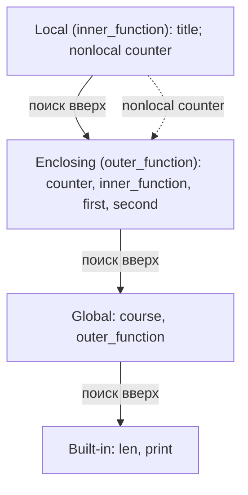

# Области видимости: global, nonlocal, порядок поиска имён (LEGB)

Код фрагмента находится в `functions_task.py` (имена `course`, `outer_function`, `inner_function`, `run_scope_asserts`).

## 1. Код фрагмента

```python
course = "Основы программирования"  # глобальное имя


def outer_function() -> int:
    counter = 0

    def inner_function() -> str:
        nonlocal counter
        counter += 1
        title = f"{course}: вызов {counter}"
        return title

    first = inner_function()
    second = inner_function()
    print(first)
    print(second)
    print("длина заголовка:", len(second))
    return counter
```

## 2. Схема областей видимости

```text
┌─ Built-in (B) ──────────────────────────────────────────────┐
│  len, print, ...                                            │
│                                                             │
│  ┌─ Global (G): модуль functions_task.py ─────────────────┐ │
│  │  course = "Основы программирования"                    │ │
│  │  outer_function                                        │ │
│  │                                                        │ │
│  │  ┌─ Enclosing (E): тело outer_function ─────────────┐  │ │
│  │  │  counter   (локальное для outer_function)        │  │ │
│  │  │  inner_function                                  │  │ │
│  │  │  first, second                                   │  │ │
│  │  │                                                  │  │ │
│  │  │  ┌─ Local (L): тело inner_function ───────────┐  │  │ │
│  │  │  │  nonlocal counter  ──► связь с E (counter) │  │  │ │
│  │  │  │  title                                     │  │  │ │
│  │  │  └────────────────────────────────────────────┘  │  │ │
│  │  └──────────────────────────────────────────────────┘  │ │
│  └────────────────────────────────────────────────────────┘ │
└─────────────────────────────────────────────────────────────┘

Порядок поиска имени изнутри наружу:  L  →  E  →  G  →  B
```

Та же схема в виде графа (Mermaid):



## 3. Порядок поиска каждого использованного имени

Правило LEGB: при чтении имени Python ищет его последовательно в областях Local, Enclosing, Global, Built-in и берёт первое найденное. Какая область считается локальной для имени, определяется при компиляции функции: если имя где-то в теле функции присваивается, оно локальное, если нет `global` или `nonlocal`.

| Имя | Где используется | Где найдено | Путь поиска и пояснение |
|---|---|---|---|
| `counter` в `inner_function` | `nonlocal counter`, `counter += 1`, f-строка | E (`outer_function`) | Объявление `nonlocal` запрещает создавать локальное имя. Python сразу привязывает имя к ближайшей объемлющей функции, где `counter` определено. Присваивание `counter += 1` меняет связывание именно в `outer_function` |
| `course` в `inner_function` | f-строка | G (модуль) | L: нет, так как в `inner_function` нет присваивания `course`. E: нет. G: найдено. Имя только читается, поэтому `global` не нужно |
| `title` в `inner_function` | присваивание и `return` | L | Присваивание внутри функции создаёт локальное имя, поиск дальше L не идёт |
| `counter` в `outer_function` | `counter = 0`, `return counter` | L (для `outer_function`) | Присваивание делает имя локальным. После двух вызовов `inner_function` имя связано со значением 2 |
| `inner_function` в `outer_function` | `inner_function()` | L (для `outer_function`) | Оператор `def` внутри функции создаёт локальное имя, оно не попадает в G |
| `first`, `second` | присваивание, `print` | L (для `outer_function`) | Присваивание создаёт локальные имена |
| `len` | `len(second)` в `outer_function` | B | L: нет. E: нет, `outer_function` не вложена в другую функцию. G: нет. B: найдено |
| `print` | `print(...)` в `outer_function` | B | Путь тот же, что у `len` |
| `outer_function` | вызов в `run_scope_asserts` и `demo` | G | Оператор `def` на уровне модуля создаёт имя в глобальной области |

## 4. Почему глобальное имя не изменяется

- В `inner_function` для `course` нет ни `global course`, ни присваивания. Имя только читается, поэтому остаётся неизменным.
- `nonlocal counter` затрагивает только `counter` в `outer_function`. Оно не может ссылаться на глобальную область: если `counter` нет в объемлющей функции, Python выдаёт `SyntaxError`.
- Проверка в коде: `assert course == original_course` и `assert "counter" not in globals()`.

## 5. Типичные ошибки (в код не включены)

- Если написать в `inner_function` `course = "другой"` без `global`, Python создаст **новое локальное** имя. Глобальный `course` не изменится, а чтение `course` до присваивания внутри той же функции вызовет `UnboundLocalError`.
- Если убрать `nonlocal counter` и оставить `counter += 1`, имя станет локальным для `inner_function`. Операция `+=` попытается прочитать ещё не определённое локальное значение и вызовет `UnboundLocalError`.

## 6. Результат запуска

```text
Основы программирования: вызов 1
Основы программирования: вызов 2
длина заголовка: 32
counter после двух вызовов inner_function: 2
глобальный course без изменений: Основы программирования
```

Значение 2 получено потому, что `inner_function` дважды увеличила `counter` из `outer_function`. Каждый новый вызов `outer_function` создаёт новое окружение, и `counter` начинается с 0.