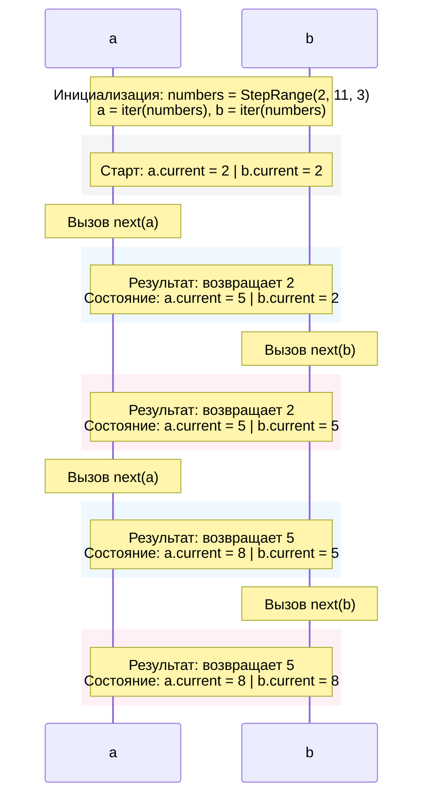

# Лабораторная работа № 4. Итераторы, генераторы и объектная модель Python

## Цель работы

Понять механизмы, лежащие в основе цикла `for`, научиться создавать ленивые последовательности и проектировать собственные типы, поддерживающие стандартные протоколы Python.


## Задание 1. Протокол итерации

Создайте `task_1.py` и исследуйте следующий код:

```python
values = [10, 20, 30]
iterator = iter(values)

print(iterator is values)
print(iter(iterator) is iterator)
print(next(iterator))
print(next(iterator))
print(next(iterator))
```
```
False
True
10
20
30
```
Добавьте четвертый вызов `next()` и зафиксируйте возникшее исключение. После этого закомментируйте строку, чтобы файл завершался без ошибки.

```
    print(next(iterator))
          ~~~~^^^^^^^^^^
StopIteration
```

Реализуйте функцию:

```python
def consume(iterable) -> list:
    """Собирает элементы iterable, вручную используя iter() и next()."""
    a=[]
    iterator = iter(iterable)
    while True:
        try:
            a.append(next(iterator))
        except StopIteration:
            return a
# Список
print('list:     ', consume([10, 20, 30]))
# Кортеж
print("tuple:    ", consume((1, 2, 3)))
# Строка
print("string:   ", consume("hello"))
# range
print("range:    ", consume(range(5)))
# Частично использованный итератор
it = iter([100, 200, 300, 400])
next(it)  # пропустили 100
next(it)  # пропустили 200
print("iterator: ", consume(it))
```
```
list:      [10, 20, 30]
tuple:     [1, 2, 3]
string:    ['h', 'e', 'l', 'l', 'o']
range:     [0, 1, 2, 3, 4]
iterator:  [300, 400]
```

Внутри функции нельзя использовать цикл `for`, преобразование `list(iterable)` и готовые функции накопления. Завершение итерации обработайте через `StopIteration`.

Проверьте функцию на:

- списке;
- кортеже;
- строке;
- объекте `range`;
- уже частично использованном итераторе.

Сравните повторный обход списка и повторный обход его итератора. Объясните, почему результаты отличаются.
```python
lst = [1, 2, 3]

# Повторный обход списка - каждый раз создаётся НОВЫЙ итератор
print(consume(lst))   # [1, 2, 3]
print(consume(lst))   # [1, 2, 3] снова всё с начала

# Повторный обход итератора - итератор ОДНОРАЗОВЫЙ
it = iter(lst)
print(consume(it))    # [1, 2, 3]
print(consume(it))    # []
```

Для списка каждый вызов `iter(lst)` внутри consume создаёт новый независимый итератор, который начинает проход с самого начала. Поэтому повторные вызовы дают одинаковый результат.

### Практическое расширение

Не используя встроенные `enumerate()` и `zip()`, реализуйте их упрощенные аналоги:

```python
def my_enumerate(iterable, start=0):
    a=[]
    it = iter(iterable)
    while True:
        try:
            a.append((start,next(it)))
            start += 1
        except StopIteration:
            return a

def my_zip(first, second):
    first=iter(first)
    second = iter(second)
    a=[]
    while True:
        try:
            a.append((next(first), next(second)))
        except StopIteration:
            return a

print(my_enumerate(['safs', 'faffa', 'faefaed']))
print(my_enumerate('aaababababa'))
print(my_enumerate(x ** 2 for x in range(5)))

print(my_zip(['safs', 'faffa', 'faefaed'], [3,56,567,4757,444]))
print(my_zip('moababababa', ['afafe','aeefef','cvxbcxb']))
print(my_zip((x ** 2 for x in range(5)), 'sjaekfjebdekf'))

print(my_enumerate(StepRange(0, 5, 1)))
print(my_zip(StepRange(0, 5, 1),StepRange(2, 11, 3)))
```
```
[(5, 'safs'), (6, 'faffa'), (7, 'faefaed')]
[(0, 'a'), (1, 'a'), (2, 'a'), (3, 'b'), (4, 'a'), (5, 'b'), (6, 'a'), (7, 'b'), (8, 'a'), (9, 'b'), (10, 'a')]
[(0, 0), (1, 1), (2, 4), (3, 9), (4, 16)]

[('safs', 3), ('faffa', 56), ('faefaed', 567)]
[('m', 'afafe'), ('o', 'aeefef'), ('a', 'cvxbcxb')]
[(0, 's'), (1, 'j'), (4, 'a'), (9, 'e'), (16, 'k')]

[(0, 0), (1, 1), (2, 2), (3, 3), (4, 4)]
[(0, 2), (1, 5), (2, 8)]
```
Обе функции должны работать с любыми итерируемыми объектами, а не только со списками. `my_zip()` завершает работу по окончании самого короткого источника. Проверьте функции на списках, строках, генераторах и объектах `StepRange` из следующего задания.


### Вопросы для анализа

1. Что должен возвращать `iter()` для итерируемого объекта?

Возращать объект типа итератор.

2. Что должен делать `next()` после исчерпания данных?

После исчерпания данных `next()` должен вызывать исключение `StopIteration`.

3. Почему итератор обычно возвращает себя при вызове `iter(iterator)`?

Итератор возвращает себя, чтобы сам итератор был итерируемым объектом и можно было многократно вызывать iter без сброса состояния - за счет этого работает for.

---

## Задание 2. Собственный итератор

Создайте класс `StepRange`, представляющий последовательность целых чисел с произвольным ненулевым шагом. Не используйте встроенный `range` для хранения или выдачи значений.

Пример:

```python
numbers = StepRange(2, 11, 3)
print(list(numbers))
# [2, 5, 8]
```

### Требования к классу

1. Конструктор принимает `start`, `stop` и `step`.
2. Нулевой шаг отклоняется с понятным сообщением.
3. Поддерживаются положительный и отрицательный шаги.
4. Объект `StepRange` можно обходить несколько раз.
5. Два независимых итератора одного объекта не влияют друг на друга.
6. Сам `StepRange` не должен хранить список всех значений.

Проверьте случаи:

```python
list(StepRange(0, 5, 1))
list(StepRange(5, 0, -1))
list(StepRange(0, 0, 1))
list(StepRange(0, 5, -1))
```
```python
class StepRangeIterator:
    def __init__(self, start, stop, step):
        self.current = start
        self.stop = stop
        self.step = step

    def __iter__(self):
        return self

    def __next__(self):
        # Положительный шаг
        if self.step > 0 and self.current >= self.stop:
            raise StopIteration
        # Отрицательный шаг
        elif self.step < 0 and self.current <= self.stop:
            raise StopIteration

        value = self.current
        self.current += self.step
        return value


class StepRange:
    def __init__(self, start, stop=None, step=1):
        if step == 0:
            raise ValueError("Шаг не может быть равен нулю")

        # Переобозначаем start и stop, если дан только 1 аргумент
        if stop is None:
            self.start = 0
            self.stop = start
        else:
            self.start = start
            self.stop = stop

        self.step = step
    def __iter__(self):
        return StepRangeIterator(self.start, self.stop, self.step)

print(list(StepRange(0, 5, 1)))
print(list(StepRange(5, 0, -1)))
print(list(StepRange(0, 0, 1)))
print(list(StepRange(0, 5, -1)))
```
```
[0, 1, 2, 3, 4]
[5, 4, 3, 2, 1]
[]
[]
```

Создайте два итератора одного диапазона и вызывайте `next()` поочередно. В отчете нарисуйте состояние обоих итераторов после каждого шага.
```python
numbers = StepRange(2, 11, 3)
a=iter(numbers)
b=iter(numbers)

print(next(a))
print(next(b))
print(next(a))
print(next(b))
print(next(a))
print(next(b))
```


### Практическое расширение

Добавьте к `StepRange` методы `__len__()`, `__contains__()` и `__repr__()`. Проверка принадлежности должна выполняться вычислением, без полного перебора диапазона. Сравните число операций при проверке через собственный `__contains__()` и через явный последовательный обход большого диапазона.

```python
    def __len__(self):
        if self.step > 0:
            if self.start >= self.stop:
                return 0
            return ceil((self.stop - self.start) / self.step)
        else:
            if self.stop >= self.start:
                return 0
            return ceil((self.start - self.stop) / abs(self.step))
    def __contains__(self, value):
        # Проверяем попадание в границы
        if self.step > 0:
            if not (self.start <= value < self.stop):
                return False
        else:
            if not (self.stop < value <= self.start):
                return False
        # Проверяем кратность шагу (остаток от деления)
        return (value - self.start) % self.step == 0

    def __repr__(self):
        """Строковое представление объекта"""
        return f"StepRange({self.start}, {self.stop}, {self.step})"
```

Через собственный __contains__() - O(1) операций - одно вычисление, а через явный обход - O(n).

### Вопросы для анализа

1. Почему состояние обхода лучше хранить в отдельном объекте?

Если хранить состояние обхода (например, текущий указатель current) внутри самого объекта StepRange, то этот объект сможет поддерживать только один активный процесс обхода одновременно. Выделение состояния в отдельный класс StepRangeIterator позволяет создавать независимые друг от друга итераторы.

2. Что произойдет, если `__iter__()` всегда будет возвращать один и тот же изменяемый итератор?

Пропадет возможность многократного обхода(так как для повторного прохода итератор уже исчерпан.

3. Сколько памяти относительно числа элементов требует `StepRange`?

StepRange требует O(1)(константный объем) памяти, так как хранит только start, stop и step, вне зависимости от числа элементов.

---

## Задание 3. Генераторы и ленивый конвейер

Создайте `task_3.py` и реализуйте генераторы:

```python
def read_measurements(lines):
    """Преобразует непустые строки в вещественные числа."""


def filter_range(values, minimum: float, maximum: float):
    """Пропускает только значения из закрытого диапазона."""


def moving_average(values, window_size: int):
    """Выдает скользящее среднее для заданного размера окна."""
```

Для тестирования используйте:

```python
raw_lines = ["10.0", "", "12.5", "100.0", "11.5", "13.0", "9.5"]
```

Постройте конвейер:

```text
строки → числа → фильтрация диапазона → скользящее среднее
```
```python
from collections import deque

def read_measurements(lines):
    """Преобразует непустые строки в вещественные числа."""
    for line in lines:
        line = line.strip()
        if line:
            yield float(line)


def filter_range(values, minimum: float, maximum: float):
    """Пропускает только значения из закрытого диапазона."""
    for value in values:
        if value >= minimum and value <= maximum:
            yield value


def moving_average(values, window_size: int):
    """Выдает скользящее среднее для заданного размера окна."""
    if not isinstance(window_size, int) or isinstance(window_size,bool) or window_size <= 0:
        raise ValueError("window_size должен быть положительным")
    window = deque(maxlen=window_size)
    for value in values:
        window.append(float(value))
        if len(window) == window_size:
            yield sum(window) / window_size


raw_lines = ["10.0", "", "12.5", "100.0", "11.5", "13.0", "9.5"]


print(list(moving_average(filter_range(read_measurements(raw_lines), 0.0, 50.0), 2)))
```
```
[11.25, 12.0, 12.25, 11.25]
```
Требования:

1. Промежуточные последовательности не преобразуются в списки.
2. Каждая функция выдает данные с помощью `yield`.
3. Окно хранит только минимально необходимое количество последних элементов.
4. Некорректный размер окна отклоняется.
5. Исходная последовательность не изменяется.

Затем:

- получите первые два значения конвейера через `next()`;
- соберите оставшиеся значения в список;
- попробуйте обойти исчерпанный генератор еще раз;
- создайте новый конвейер и сравните поведение.

```python
a=moving_average(filter_range(read_measurements(raw_lines), 0.0, 50.0), 2)
print(next(a))
print(next(a))
print(list(a))
#print(next(a)) StopIteration

new=moving_average(filter_range(read_measurements(raw_lines), 0.0, 50.0), 2)
print(list(new))
```
```
11.25
12.0
[12.25, 11.25]
[11.25, 12.0, 12.25, 11.25]
```
Дополнительно создайте:

- список квадратов четных чисел от 1 до 20;
- множество длин непустых строк;
- словарь `число: квадрат` для чисел от 1 до 10;
- генераторное выражение для суммы квадратов большого диапазона.

```python
even_squares=[x**2 for x in range(1, 21) if x%2==0]
print(even_squares)

lengths = {len(s) for s in raw_lines if s}
print(lengths)

dict_squares={n:n**2 for n in range(1,11)}
print(dict_squares)

sum_gen = sum(x**2 for x in range(1, 100001))
print(sum_gen)
```
```
[4, 16, 36, 64, 100, 144, 196, 256, 324, 400]
{3, 4, 5}
{1: 1, 2: 4, 3: 9, 4: 16, 5: 25, 6: 36, 7: 49, 8: 64, 9: 81, 10: 100}
333383335000
```

Объясните различия между включением и генераторным выражением с точки зрения времени вычисления и памяти.

Включение(список) вычисляет и сохраняет весь список целиком в оперативную память сразу в момент выполнения, работает за O(n) по памяти и позволяет многократно проходить по списку.
Генераторное выражение вычисляет элементы лениво, по одному значению при запросе, хранит только текущее состояние, работает за O(n) по памяти. Нельзя индексировать и повторно обходить.

### Практическое расширение

Создайте универсальные генераторы `take(n, iterable)`, `drop(n, iterable)` и `batch(iterable, size)`. Объедините их с конвейером измерений и сформируйте несколько пакетов обработанных значений. Запрещено преобразовывать весь входной источник в список внутри этих генераторов.

С помощью `tracemalloc` сравните пиковую память ленивого конвейера и варианта, который на каждом этапе создает новый список из 100 000 чисел.

```python
def check(n):
    if not isinstance(n, int) or isinstance(n,bool) or n < 0:
        raise ValueError("n(или size) должен быть целым числом >= 0")

def take(n, iterable):
    check(n)
    it = iter(iterable)
    for _ in range(n):
        try:
            yield next(it)
        except StopIteration:
            return


def drop(n, iterable):
    check(n)
    it = iter(iterable)
    for _ in range(n):
        try:
            next(it)
        except StopIteration:
            return
    yield from it


def batch(iterable, size):
    check(size)
    current = []
    for item in iterable:
        current.append(item)
        if len(current) == size:
            yield current
            current = []
    if current:
        yield current

# take(n, it) делает ровно n обращений к next() и останавливается
p=moving_average(filter_range(read_measurements(raw_lines), 0.0, 50.0), 2)
print(list(take(2, p)))
# drop(n, it) пропускает n элементов через next(), затем делает yield из it
dr=moving_average(filter_range(read_measurements(raw_lines), 0.0, 50.0), 2)
print(list(drop(2, dr)))
# batch(it, size) копит не больше size элементов в буфере, при заполнении отдаёт tuple и очищает буфер. Остаток отдаётся последним пакетом
bat=moving_average(filter_range(read_measurements(raw_lines), 0.0, 50.0), 2)
print(list(batch(bat, 2)))


mem_test=(str(x**2) for x in range(100_000))

def gen():
    pipe = moving_average(filter_range(read_measurements(mem_test), 0, 100_000), 3)
    for _ in pipe:
        pass
def with_lists():
    a = [x**2 for x in range(100_000)]
    b = [float(s) for s in a]
    c = [x for x in b if 0 <= x < 100_000]
    d = [sum(c[i:i + 3]) / 3 for i in range(len(c) - 2)]


tracemalloc.start()
# get_traced_memory() возвращает (current, peak) в байтах
gen()
current, peak = tracemalloc.get_traced_memory()
print('Lazy generator:')
print("Current memory: %.1f KiB" % (current / 1024))
print("Peak memory: %.1f KiB" % (peak / 1024))
tracemalloc.stop()

tracemalloc.start()
with_lists()
current1, peak1 = tracemalloc.get_traced_memory()
print('With lists:')
print("Current memory: %.1f KiB" % (current1 / 1024))
print("Peak memory: %.1f KiB" % (peak1 / 1024))
tracemalloc.stop()
```
```
[11.25, 12.0]
[12.25, 11.25]
[[11.25, 12.0], [12.25, 11.25]]
Lazy generator:
Current memory: 0.0 KiB
Peak memory: 2.1 KiB
With lists:
Current memory: 5.5 KiB
Peak memory: 7045.0 KiB
```
---

## Задание 4. Модель предметной области

Создайте объектную модель системы сдачи лабораторных работ.

### Класс `Submission`

Оформите класс как `dataclass`. Он должен содержать:

- `student_id: str`;
- `laboratory_id: str`;
- `attempt: int`;
- `score: float`;
- `comment: str = ""`.

Добавьте проверку основных инвариантов в `__post_init__()`:

- идентификаторы не пустые;
- номер попытки положительный;
- результат находится в диапазоне от 0 до 100.