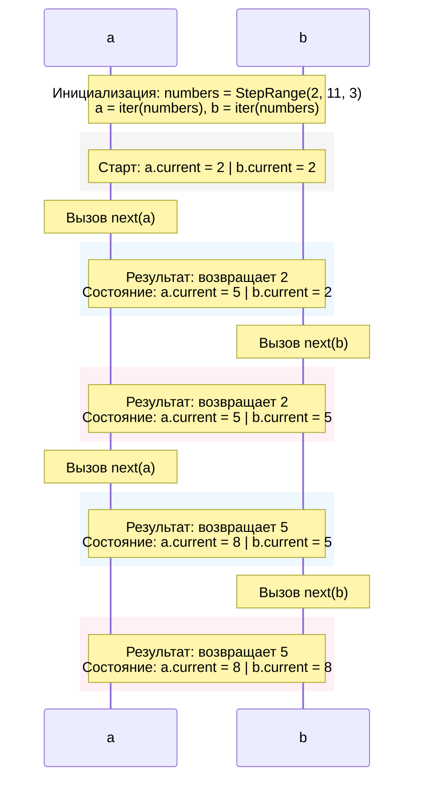

# Лабораторная работа № 4. Итераторы, генераторы и объектная модель Python

## Цель работы

Понять механизмы, лежащие в основе цикла `for`, научиться создавать ленивые последовательности и проектировать собственные типы, поддерживающие стандартные протоколы Python.


## Задание 1. Протокол итерации

Создайте `task_1.py` и исследуйте следующий код:

```python
values = [10, 20, 30]
iterator = iter(values)

print(iterator is values)
print(iter(iterator) is iterator)
print(next(iterator))
print(next(iterator))
print(next(iterator))
```
```
False
True
10
20
30
```
Добавьте четвертый вызов `next()` и зафиксируйте возникшее исключение. После этого закомментируйте строку, чтобы файл завершался без ошибки.

```
    print(next(iterator))
          ~~~~^^^^^^^^^^
StopIteration
```

Реализуйте функцию:

```python
def consume(iterable) -> list:
    """Собирает элементы iterable, вручную используя iter() и next()."""
    a=[]
    iterator = iter(iterable)
    while True:
        try:
            a.append(next(iterator))
        except StopIteration:
            return a
# Список
print('list:     ', consume([10, 20, 30]))
# Кортеж
print("tuple:    ", consume((1, 2, 3)))
# Строка
print("string:   ", consume("hello"))
# range
print("range:    ", consume(range(5)))
# Частично использованный итератор
it = iter([100, 200, 300, 400])
next(it)  # пропустили 100
next(it)  # пропустили 200
print("iterator: ", consume(it))
```
```
list:      [10, 20, 30]
tuple:     [1, 2, 3]
string:    ['h', 'e', 'l', 'l', 'o']
range:     [0, 1, 2, 3, 4]
iterator:  [300, 400]
```

Внутри функции нельзя использовать цикл `for`, преобразование `list(iterable)` и готовые функции накопления. Завершение итерации обработайте через `StopIteration`.

Проверьте функцию на:

- списке;
- кортеже;
- строке;
- объекте `range`;
- уже частично использованном итераторе.

Сравните повторный обход списка и повторный обход его итератора. Объясните, почему результаты отличаются.
```python
lst = [1, 2, 3]

# Повторный обход списка - каждый раз создаётся НОВЫЙ итератор
print(consume(lst))   # [1, 2, 3]
print(consume(lst))   # [1, 2, 3] снова всё с начала

# Повторный обход итератора - итератор ОДНОРАЗОВЫЙ
it = iter(lst)
print(consume(it))    # [1, 2, 3]
print(consume(it))    # []
```

Для списка каждый вызов `iter(lst)` внутри consume создаёт новый независимый итератор, который начинает проход с самого начала. Поэтому повторные вызовы дают одинаковый результат.

### Практическое расширение

Не используя встроенные `enumerate()` и `zip()`, реализуйте их упрощенные аналоги:

```python
def my_enumerate(iterable, start=0):
    a=[]
    it = iter(iterable)
    while True:
        try:
            a.append((start,next(it)))
            start += 1
        except StopIteration:
            return a

def my_zip(first, second):
    first=iter(first)
    second = iter(second)
    a=[]
    while True:
        try:
            a.append((next(first), next(second)))
        except StopIteration:
            return a

print(my_enumerate(['safs', 'faffa', 'faefaed']))
print(my_enumerate('aaababababa'))
print(my_enumerate(x ** 2 for x in range(5)))

print(my_zip(['safs', 'faffa', 'faefaed'], [3,56,567,4757,444]))
print(my_zip('moababababa', ['afafe','aeefef','cvxbcxb']))
print(my_zip((x ** 2 for x in range(5)), 'sjaekfjebdekf'))

print(my_enumerate(StepRange(0, 5, 1)))
print(my_zip(StepRange(0, 5, 1),StepRange(2, 11, 3)))
```
```
[(5, 'safs'), (6, 'faffa'), (7, 'faefaed')]
[(0, 'a'), (1, 'a'), (2, 'a'), (3, 'b'), (4, 'a'), (5, 'b'), (6, 'a'), (7, 'b'), (8, 'a'), (9, 'b'), (10, 'a')]
[(0, 0), (1, 1), (2, 4), (3, 9), (4, 16)]

[('safs', 3), ('faffa', 56), ('faefaed', 567)]
[('m', 'afafe'), ('o', 'aeefef'), ('a', 'cvxbcxb')]
[(0, 's'), (1, 'j'), (4, 'a'), (9, 'e'), (16, 'k')]

[(0, 0), (1, 1), (2, 2), (3, 3), (4, 4)]
[(0, 2), (1, 5), (2, 8)]
```
Обе функции должны работать с любыми итерируемыми объектами, а не только со списками. `my_zip()` завершает работу по окончании самого короткого источника. Проверьте функции на списках, строках, генераторах и объектах `StepRange` из следующего задания.


### Вопросы для анализа

1. Что должен возвращать `iter()` для итерируемого объекта?

Возращать объект типа итератор.

2. Что должен делать `next()` после исчерпания данных?

После исчерпания данных `next()` должен вызывать исключение `StopIteration`.

3. Почему итератор обычно возвращает себя при вызове `iter(iterator)`?

Итератор возвращает себя, чтобы сам итератор был итерируемым объектом и можно было многократно вызывать iter без сброса состояния - за счет этого работает for.

---

## Задание 2. Собственный итератор

Создайте класс `StepRange`, представляющий последовательность целых чисел с произвольным ненулевым шагом. Не используйте встроенный `range` для хранения или выдачи значений.

Пример:

```python
numbers = StepRange(2, 11, 3)
print(list(numbers))
# [2, 5, 8]
```

### Требования к классу

1. Конструктор принимает `start`, `stop` и `step`.
2. Нулевой шаг отклоняется с понятным сообщением.
3. Поддерживаются положительный и отрицательный шаги.
4. Объект `StepRange` можно обходить несколько раз.
5. Два независимых итератора одного объекта не влияют друг на друга.
6. Сам `StepRange` не должен хранить список всех значений.

Проверьте случаи:

```python
list(StepRange(0, 5, 1))
list(StepRange(5, 0, -1))
list(StepRange(0, 0, 1))
list(StepRange(0, 5, -1))
```
```python
class StepRangeIterator:
    def __init__(self, start, stop, step):
        self.current = start
        self.stop = stop
        self.step = step

    def __iter__(self):
        return self

    def __next__(self):
        # Положительный шаг
        if self.step > 0 and self.current >= self.stop:
            raise StopIteration
        # Отрицательный шаг
        elif self.step < 0 and self.current <= self.stop:
            raise StopIteration

        value = self.current
        self.current += self.step
        return value


class StepRange:
    def __init__(self, start, stop=None, step=1):
        if step == 0:
            raise ValueError("Шаг не может быть равен нулю")

        # Переобозначаем start и stop, если дан только 1 аргумент
        if stop is None:
            self.start = 0
            self.stop = start
        else:
            self.start = start
            self.stop = stop

        self.step = step
    def __iter__(self):
        return StepRangeIterator(self.start, self.stop, self.step)

print(list(StepRange(0, 5, 1)))
print(list(StepRange(5, 0, -1)))
print(list(StepRange(0, 0, 1)))
print(list(StepRange(0, 5, -1)))
```
```
[0, 1, 2, 3, 4]
[5, 4, 3, 2, 1]
[]
[]
```

Создайте два итератора одного диапазона и вызывайте `next()` поочередно. В отчете нарисуйте состояние обоих итераторов после каждого шага.
```python
numbers = StepRange(2, 11, 3)
a=iter(numbers)
b=iter(numbers)

print(next(a))
print(next(b))
print(next(a))
print(next(b))
print(next(a))
print(next(b))
```


### Практическое расширение

Добавьте к `StepRange` методы `__len__()`, `__contains__()` и `__repr__()`. Проверка принадлежности должна выполняться вычислением, без полного перебора диапазона. Сравните число операций при проверке через собственный `__contains__()` и через явный последовательный обход большого диапазона.

```python
    def __len__(self):
        if self.step > 0:
            if self.start >= self.stop:
                return 0
            return ceil((self.stop - self.start) / self.step)
        else:
            if self.stop >= self.start:
                return 0
            return ceil((self.start - self.stop) / abs(self.step))
    def __contains__(self, value):
        # Проверяем попадание в границы
        if self.step > 0:
            if not (self.start <= value < self.stop):
                return False
        else:
            if not (self.stop < value <= self.start):
                return False
        # Проверяем кратность шагу (остаток от деления)
        return (value - self.start) % self.step == 0

    def __repr__(self):
        """Строковое представление объекта"""
        return f"StepRange({self.start}, {self.stop}, {self.step})"
```

Через собственный __contains__() - O(1) операций - одно вычисление, а через явный обход - O(n).

### Вопросы для анализа

1. Почему состояние обхода лучше хранить в отдельном объекте?

Если хранить состояние обхода (например, текущий указатель current) внутри самого объекта StepRange, то этот объект сможет поддерживать только один активный процесс обхода одновременно. Выделение состояния в отдельный класс StepRangeIterator позволяет создавать независимые друг от друга итераторы.

2. Что произойдет, если `__iter__()` всегда будет возвращать один и тот же изменяемый итератор?

Пропадет возможность многократного обхода(так как для повторного прохода итератор уже исчерпан.

3. Сколько памяти относительно числа элементов требует `StepRange`?

StepRange требует O(1)(константный объем) памяти, так как хранит только start, stop и step, вне зависимости от числа элементов.

---

## Задание 3. Генераторы и ленивый конвейер

Создайте `task_3.py` и реализуйте генераторы:

```python
def read_measurements(lines):
    """Преобразует непустые строки в вещественные числа."""


def filter_range(values, minimum: float, maximum: float):
    """Пропускает только значения из закрытого диапазона."""


def moving_average(values, window_size: int):
    """Выдает скользящее среднее для заданного размера окна."""
```

Для тестирования используйте:

```python
raw_lines = ["10.0", "", "12.5", "100.0", "11.5", "13.0", "9.5"]
```